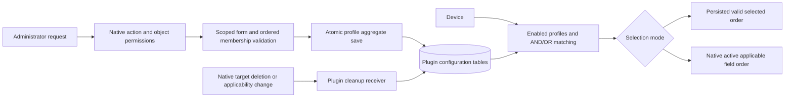

# Phase 2: Profile administration and matching — Research

**Researched:** 2026-11-06
**Domain:** NetBox 4.7.4 plugin administration, native custom-field references, matching and lifecycle safety
**Confidence:** MEDIUM overall; actual installed source inspected, proposed integration still requires runtime tests.

<user_constraints>
## User Constraints (from CONTEXT.md)

### Locked Decisions

### Profile administration
- **D-01:** Manage profiles through standard NetBox plugin pages: list, add, edit,
  delete, accessible under Custom Field Profiles. Django-admin-only or dual
  administration was not selected.
- **D-02:** One title identifies the profile in administration and supplies its
  eventual section heading; no separate internal name or override title.
- **D-03:** Duplicate titles are allowed, including profiles with different filters.
- **D-04:** The list shows title, enabled state, display order, field-selection mode,
  and a readable applicability-filter summary.

### Field selection and ordering
- **D-05:** Selected fields are arranged by drag-to-reorder.
- **D-06:** All applicable fields dynamically follows native NetBox custom-field
  ordering, including newly applicable fields; do not replace with alphabetical
  label/internal-name ordering.
- **D-07:** Switching to All applicable fields remembers the manual selection and
  its order. Ignore that selection in All mode and restore it on switching back.
- **D-08:** Selected mode requires at least one applicable field when an
  administrator saves a configuration. Loss of fields through external changes
  follows D-14; do not block native deletion merely to maintain this form invariant.

### Filter configuration
- **D-09:** Provide three optional searchable multi-selects: Device Type, device
  role, and tag, rather than a repeatable rule-row editor. Empty selectors impose
  no restriction. AND across populated criteria; OR within each criterion, including
  any selected tag, remains locked by the agreed requirements.
- **D-10:** With all selectors empty, show an inline “Applies to all Devices” notice.
  Do not require an extra unrestricted-profile save confirmation.
- **D-11:** New profiles start disabled. An administrator enables them explicitly
  after configuring them.
- **D-12:** The tag selector includes all tags available for Devices, including tags
  not currently assigned to a Device; do not restrict choices to used tags.

### Changes and deletion
- **D-13:** Deleting any referenced Device Type, role, or tag disables every affected
  profile for review. Do not silently broaden matching and do not block native
  deletion instead. Profiles stay disabled until explicitly re-enabled (D-16).
- **D-14:** If a selected custom field is deleted or loses Device applicability,
  remove its invalid selected membership. Keep profiles with valid remaining
  selected fields usable; disable a Selected-mode profile if none remain. Native
  field settings and stored values are never modified as a side effect.
- **D-15:** Equal profile display-order numbers sort alphabetically by title, then
  by creation order (oldest first) when titles also match. Duplicate titles must
  still produce deterministic ordering.
- **D-16:** Correcting an automatically disabled profile does not re-enable it.
  Require an explicit administrator action to enable it again.

### Implementation discretion and inherited constraints
- No specific “you decide” answer was given; the 16 choices above are locked.
  Research/planning chooses internal model structure, native framework integration,
  validation, accessible reorder mechanics, and technical ordering tie-breaks
  consistent with those choices. Do not turn these into additional product scope.
- Devices only, a single object type per profile, existing native fields only,
  Selected/All modes, multiple profiles and duplicate field occurrences across
  profiles remain inherited requirements. Filters affect relevance, not authority.
- Phase 1 established the normal root checkout on milestone/custom-field-profiles,
  NetBox 4.7.4 / Docker packaging 5.1.1, native generated migrations and the dedicated
  sandbox. No worktrees or per-phase branches. The plugin is undeployed; no legacy
  installation upgrade is required. Preserve native values when replacing old
  configuration structures.

### Deferred Ideas (OUT OF SCOPE)

No new scope was introduced. Parameters tab/no-match/empty-value presentation
belongs to Phase 3; native editing to Phase 4; full acceptance/release to Phase 5.
Other object types, arbitrary filter expressions and nested grouping remain out
of this milestone as already agreed.
</user_constraints>

## Project Constraints (from AGENTS.md)

[VERIFIED: AGENTS.md, read in this research] Read the agreed requirements before planning; product authority overrides the earlier panel design. Read current state, roadmap, traceable requirements, README and CLAUDE background. Phase 2 planning does not authorize implementation. Use the canonical root milestone checkout; do not create worktrees or per-phase branches; do not edit/prune the retired recovery copy. The existing panel architecture is historical context, not the profile contract.

## Summary

Use a new plural profile model with ordered explicit memberships, three fixed reference sets and a reusable matching/field-resolution service. Keep native definitions and Device values outside every profile write path. Build the first production slice through the actual NetBox administration pages, native database, and matching result, then expand selection modes, filters and lifecycle coverage. These are implementation recommendations within the discretion granted by CONTEXT, not additional product decisions. [VERIFIED: 02-CONTEXT.md decisions D-01–D-16 and discretion section]

The actual installed NetBox source is more authoritative than old repository tests or generic documentation. It provides per-action and constrained-object permissions through generic views, native searchable widgets, and an ordered active-field resolver. Native deletion and applicability changes already have their own data cleanup. Plugin receivers must update only plugin tables, run transactionally and be idempotent; they must not undo or duplicate NetBox's own native behavior. [VERIFIED: installed netbox/views/generic/object_views.py:183-212,280-309; utilities/views.py:106-153; extras/models/customfields.py:68-106,615-631,655-724; extras/signals.py:30-108]

**Primary recommendation:** Put aggregate profile validation and membership persistence in a NetBoxModelForm used by ObjectEditView; expose matching and ordered field resolution independently for Phases 3–4, and test lifecycle changes in native PostgreSQL before the first slice can pass.

## Architectural Responsibility Map

| Capability | Primary owner | Secondary owner | Rationale |
|---|---|---|---|
| Profile identity and reference sets | Database/model | Form | Persist configuration only; enforce uniqueness within one membership set |
| CRUD permissions and constrained object access | NetBox generic views | Restricted form querysets | Reuse native enforcement rather than UI-only restrictions |
| Selection mode, ordered membership validation | Backend form/service | Database constraints | Reject forged IDs, duplicates and invalid order payloads |
| Search and drag interaction | Browser | Server revalidation | Browser determines proposed order; server owns accepted state |
| Profile matching and field resolution | Backend service | ORM | One reusable source for later display/edit consumers |
| Native target cleanup | Transactional signal adapter | Backend cleanup service | External/native edits must also maintain plugin configuration |

This table is a proposed responsibility assignment based on inspected native interfaces and locked scope. [VERIFIED: 02-CONTEXT.md integration points; installed native source listed below]

<phase_requirements>
## Phase Requirements

| ID | Behavior | Research support |
|---|---|---|
| PROF-01 | Multiple profiles with list/create/edit/delete | Plural NetBoxModel, generic CRUD views, no unique title/type |
| PROF-02 | Device-only selector and scoped fields | Validate concrete Device content type; native field applicability plus server validation |
| PROF-03 | Title/order/enabled | One title, default disabled, stable total ordering |
| PROF-04 | Ordered selected fields | Explicit through model; validated ordered ID payload |
| PROF-05 | Dynamic all-applicable fields | Resolve native active applicable fields on each use |
| PROF-06 | Duplicate field across profiles | Unique only on profile/field pair |
| MATCH-01 | Device Type/role/tag rules | Three normal native-model reference sets |
| MATCH-02 | AND across sets; OR within sets | Fixed boolean service; any-tag intersection; distinct profile results |
| MATCH-03 | No rules matches all; enabled only | Empty-set convention and enabled filter; default disabled |
| DATA-01 | Native definitions/values unchanged by profile management | Read-only native references; snapshot/diff regression tests |

Descriptions condensed from the authoritative requirements. [VERIFIED: .planning/REQUIREMENTS.md, Profile administration and matching]
</phase_requirements>

## Standard Stack

| Component | Version/evidence | Use |
|---|---|---|
| Existing NetBox image | `IMAGE = 'netboxcommunity/netbox:v4.7.4-5.1.1'` [VERIFIED: scripts/sandbox.py:16-20] | The supported runtime; do not upgrade during this phase |
| Native Django | `6.1.2` [VERIFIED: container `python -m django --version`, 2026-11-06] | ORM, ModelForm, signals, transactions, Django TestCase |
| NetBox generic CRUD | Native installed source inspected | ObjectListView, ObjectView, ObjectEditView, ObjectDeleteView |
| Native dynamic choices | `DynamicModelMultipleChoiceField` [VERIFIED: installed utilities/forms/fields/dynamic.py:9-14,57-113] | Device Type, role, tag searches using existing APIs |
| Existing NetBox styling/assets | Native installed project-static/package.json read | Reuse existing form styles and search widgets |
| Browser ordering | Small plugin-owned JS and server validated payload | Native drag events plus accessible move controls; no new package |

**Installation:** No external packages recommended. Reuse the dependencies already installed with the pinned NetBox image. Package legitimacy audit is therefore not applicable. A future executor choosing an additional dependency must verify it separately rather than infer authorization from this research.

**Documentation lookup:** Research-plan seam selected Context7, but neither Context7 MCP nor `ctx7` CLI was available. Used official docs plus actual installed source instead. `classify-confidence --provider context7 --verified` returned MEDIUM; fallback `webfetch --verified` returned LOW. Overall confidence remains MEDIUM because version-specific recommendations are grounded in inspected local runtime source, with integration tests still pending. Do not treat generic stable docs as proof of exact-version behavior.

## Architecture Patterns



The diagram describes the recommended flow, grounded in scope and native hooks. Native definitions and Device values are read by resolution and never written by profile save/cleanup.

### Profile aggregate

Recommended new concepts (proposed names, not existing identifiers): **CustomFieldProfile**, **ProfileField**, and a matching/resolution module. Profile inherits NetBoxModel, has a nonunique title, display order, default-disabled boolean, Device content-type FK and an explicit field-mode choice. Use native-model M2M references for Device Types, roles and applicability tags. Name applicability tags distinctly from NetBoxModel's inherited own-object tags; otherwise profile metadata tags and Device matching tags collide. NetBoxModel inherits TagsMixin. [VERIFIED: installed netbox/models/__init__.py:28-40,134-140; existing models.py read]

Membership has profile FK, native CustomField FK, integer position and a database uniqueness constraint on profile/field. Do not impose global uniqueness on CustomField or title. Preserve membership rows in All mode; mode changes alter interpretation, not membership storage. On any form save in Selected mode, require at least one valid applicable selected field. Perform aggregate validation in the form/service because unsaved objects cannot validate their M2M state through a simple model clean. These recommendations implement D-03/D-07/D-08/PROF-06.

Use deterministic profile ordering by display order, title, creation time, then PK as final stabilizer. Creation time matches the agreed oldest-first intent; PK breaks timestamp ties. Choose and test a consistent alphabetical comparison under the supported database rather than letting a table's incidental sort reverse tie behavior. Do not substitute ordering by title alone.

### Native CRUD and atomic saves

Prefer ObjectEditView rather than the retained custom Django View. Native dispatch chooses permission action with the exact expression `'change' if kwargs else 'add'`; it restricts the view queryset to permitted objects, restricts referenced form fields, snapshots for changelog, saves in a transaction and rejects saved objects outside assigned constraints. [VERIFIED: installed netbox/views/generic/object_views.py:194-212,282-309; utilities/views.py:125-135; utilities/forms/utils.py:239-246]

Place ordered-membership persistence in a deliberate aggregate form save implementation that honors `commit=False`/`save_m2m` and participates in the native view transaction. Validate the ordered field IDs against the scoped ModelMultipleChoiceField queryset, then require exact membership equality, uniqueness and an unambiguous order; do not trust a hidden JSON list by itself. Avoid exposing the through relation as a normal unordered model M2M form field that can accidentally run `.set()` and erase/recreate remembered order. Preserve NetBoxModelForm's existing M2M behavior for the native reference selectors. [VERIFIED: installed netbox/forms/model_forms.py:72-116; forms.py existing unordered global choices]

Validate on both browser and backend that object type is Device and selected fields are Device-applicable. Native widgets' query parameters constrain discovery, while the form queryset constrains forged POSTs. Restricted form querysets must include selected choices the user is allowed to reference; never silently clear an inaccessible saved filter because its browser option was absent. A failed edit must preserve all previously stored memberships and rules.

### Searchable filters and the important tag distinction

Native tag filter definitions expose the exact API parameter `for_object_type_id`; its implementation returns tags with matching object-type restriction **or no restriction**. In contrast, `content_type_id` searches tags through existing TaggedItem assignments. Using the latter violates D-12 by excluding unused tags. [VERIFIED: installed extras/filtersets.py:580-588,622-632; exact values `content_type_id`, `for_object_type_id`; extras/models/tags.py:38-43]

Use Device content-type ID with `for_object_type_id` for dynamic widget discovery, and the equivalent server-side allowed-tag queryset, deduplicated. Do not require tags to be attached to Devices already. Native custom-field discovery exposes exact parameter `object_type_id`, mapped to `field_name='object_types'`. [VERIFIED: installed extras/filtersets.py:166-172]

### Matching and field resolution

Implement the fixed rule semantics directly: each empty reference set is true; each populated Device Type or role set accepts membership; tag set accepts any intersection with Device tags; combine those three booleans with AND; include enabled profiles only. Avoid general expression engines. If implementing matching with joins, deduplicate profiles when several tags match. Prefetch profile memberships/reference sets for repeated resolution rather than querying once per field.

All mode should use `CustomField.objects.get_for_model(Device)` without an overriding `.order_by('name')`. Native manager returns an ordered list, not a queryset, and excludes nonactive lifecycle states. Its model ordering is exactly `ordering = ['group_name', 'weight', 'name']`. [VERIFIED: installed extras/models/customfields.py:71-106,334-337]

Selected mode intersects remembered membership with current native applicability and live-field resolution, retaining persisted order. Distinguish **permanent loss of applicability/deletion** from **temporary provisioning state**: do not destroy remembered selected membership just because a field is temporarily absent from the active resolver. Native lifecycle constants are exactly `STATUS_ACTIVE = 'active'`, `STATUS_PROVISIONING = 'provisioning'`, `STATUS_DELETING = 'deleting'`. [VERIFIED: installed extras/choices.py:50-73]

### Lifecycle safety

Use plugin signal receivers registered once from plugin ready, with stable dispatch identifiers. Put cleanup in small shared idempotent helpers. Respect the signal database alias and transaction; do not defer safety disabling until after commit, where a broadening window would remain. These are implementation recommendations based on Django's documented signal interface. [CITED: https://docs.djangoproject.com/en/6.1/ref/signals/]

**Filter target deletion (D-13/D-16):** receive pre_delete for native Device Type, role and Tag; identify every referencing profile while relation rows still exist and set enabled false. Let native deletion/cascade proceed. Do not rely solely on profile-rule m2m_changed: target deletion is a different lifecycle path. A user deliberately removing a filter on the profile edit form is not a deleted target and should not trigger an extra confirmation or automatic disabling. QuerySet deletion emits delete signals even though it bypasses per-instance delete overrides. [CITED: https://docs.djangoproject.com/en/6.1/ref/signals/; https://docs.djangoproject.com/en/6.1/ref/models/querysets/#delete]

**Selected field deletion (D-14):** receive native CustomField pre_delete, remove all plugin selected-membership rows referencing it explicitly, then disable Selected profiles left with none. Explicit removal matters because native deferred field deletion can send pre_delete and post_delete while retaining the native row until a background purge finishes. Handle repeated signals safely. All-mode profiles do not disable merely because their remembered manual set becomes empty. Never re-enable any profile in cleanup. [VERIFIED: installed extras/models/customfields.py:655-724, especially717-718; extras/signals.py:72-108]

**Applicability loss (D-14):** receive m2m_changed for CustomField.object_types.through, handling forward and reverse removal/clear. Clear gives no pk_set, so capture affected field IDs before clearing; after removal determine which fields truly lost Device applicability, remove only their plugin memberships and disable newly empty Selected profiles. Cover `.remove()`, `.clear()`, `.set()` and reverse-manager operations in tests. Native code itself ignores reverse object-type changes, so do not copy that omission into plugin cleanup. Direct through-table SQL/bulk_create bypasses relation-manager signals: document this boundary and guard resolution against stale membership anyway; do not silently claim arbitrary SQL edits are synchronously handled. [VERIFIED: installed extras/signals.py:30-61; CITED: https://docs.djangoproject.com/en/6.1/ref/signals/]

**Native data distinction:** NetBox's own handlers call remove_data/remove_stale_data when a native field is removed or unassigned. DATA-01 means **profile management and plugin cleanup** must not write native values/settings; it does not require preventing native deletion from doing its standard cleanup. Test preservation during profile CRUD/mode/filter edits independently, and test unrelated native values remain untouched during native deletion scenarios. [VERIFIED: installed extras/signals.py:46-61,72-80; extras/models/customfields.py:615-631]

## Don't Hand-Roll

| Problem | Use | Avoid |
|---|---|---|
| Authentication, CSRF, action/object permissions | Native generic CRUD and restricted querysets | Copying the old permission tuple/custom View |
| Searchable reference selectors | Native DynamicModelMultipleChoiceField and APIs | New AJAX search endpoints |
| Native applicable/live field order | Native manager | Separate cached field catalog or alphabetic reorder |
| Database validation/transactions | ModelForm, ORM constraints, transaction.atomic | Trusting JS payloads or partial form saves |
| Native field data lifecycle | Leave native handlers in charge | Calling field.save, remove_data or Device.save from plugin cleanup |
| Phase 3/4 display/edit behavior | Reusable resolution boundary only | Implementing tab or value editing during this phase |

Recommendations are supported by the inspected native interfaces and locked scope above.

## Runtime State Inventory

| Category | Observed evidence | Required action |
|---|---|---|
| Stored data | Existing generated initial migration creates old config/group/field tables [VERIFIED: migrations/0001_initial.py read] | Add a forward generated migration creating profiles and removing/replacing only old plugin configuration; preserve native tables and Device JSON |
| Live service config | Compose mounts root source/config and installs editable plugin [VERIFIED: docker-compose.yml and docker/Dockerfile read] | Restart web/worker after schema/registration changes; collect new static assets as required |
| OS registrations | No OS-registration change is proposed by this phase; sandbox orchestration uses Docker Compose [VERIFIED: scripts/sandbox.py:105-110] | No host registration work is required by this design; no exhaustive workstation OS inventory was performed |
| Secrets/env | Local environment is created once and retained by sandbox helper [VERIFIED: scripts/sandbox.py:64-101] | Preserve environment keys and credentials; never put their values in artifacts |
| Built/installed artifacts | Dockerfile editable install plus runtime bind mount [VERIFIED: docker/Dockerfile and docker-compose.yml read] | Verify wheel includes new templates/static assets; rebuild/collectstatic/restart when needed |

The plugin is undeployed and Phase 1 agreed no legacy deployment upgrade path. Do not build an elaborate mapping from old nested group configurations to profiles. A forward migration may drop old plugin config after an explicit execution checkpoint because deletion of old configuration is a one-way schema decision, even in the disposable sandbox. Keep the existing initial migration as history rather than casually rewriting an already-applied migration. Retire old model imports/routes/menu/API/admin/template extension references together so native app checks continue to boot. [VERIFIED: Phase 1 CONTEXT D-07; Phase 2 CONTEXT inherited constraints; existing __init__.py, urls.py, navigation.py, models.py read]

## Common Pitfalls

- Treating inherited NetBoxModel metadata tags as applicability tags; use separate fields.
- Alphabetical custom-field order instead of native group/weight/name order.
- Using used-tag filtering instead of tags available to Devices.
- Losing remembered field selections when switching modes or posting disabled inputs.
- Deleting selected membership because a field is temporarily provisioning.
- Relying only on model.delete overrides or m2m signals for target deletion.
- Waiting for physical deletion when native deferred deletion has already dispatched signals.
- Clearing every selected field in pre_clear regardless of whether Device applicability was actually lost.
- Implicitly re-enabling a corrected profile or disabling all-mode profiles for an empty remembered selection.
- Claiming preservation of the deleted native field's value after NetBox itself removes it.
- Testing only superusers, bypassing action-specific and constrained permissions.
- Replacing models without retiring import consumers, leaving startup/system checks broken.

Each pitfall follows from the source findings and decisions cited above; the test map below turns them into execution checks.

## Code Examples

Verified native call patterns (the following identifiers exist in inspected source):

```python
# Native extras/models/customfields.py:71-106,334-337
native_fields = CustomField.objects.get_for_model(Device)
# Native ordering is ['group_name', 'weight', 'name']; preserve list order.

# Native extras/filtersets.py:629-632; this is query logic, not an extra API.
available_tags = Tag.objects.filter(
    Q(object_types__id__in=[device_content_type.pk]) |
    Q(object_types__isnull=True)
).distinct()
```

`device_content_type` and `native_fields` are illustrative local variables, not existing project identifiers. The Device-only object choice and proposed model/field-mode names must be defined by implementation, not imported from this document as if already present.

## Validation Architecture

### Test Framework

| Property | Recommendation/evidence |
|---|---|
| Framework | Django TestCase with native NetBox settings and PostgreSQL; Django 6.1.2 already installed |
| Existing baseline | `make test` runs helper/config/runtime/session/API/seed checks [VERIFIED: Makefile read] |
| Feature runner | Add explicit native-Django feature target; do not require optional pytest or historical SQLite settings |
| Quick command | Proposed `make test-profiles` with focused Django labels; run isolated test DB and fail on zero discovered tests |
| Full command | Proposed `make test-profiles` plus existing `make test` |
| Native command building block | `python3 scripts/sandbox.py compose exec -T netbox /opt/netbox/venv/bin/python /opt/netbox/netbox/manage.py test --noinput` |

The exact native interpreter and management script constants are `PYTHON = '/opt/netbox/venv/bin/python'` and `MANAGE = '/opt/netbox/netbox/manage.py'`. [VERIFIED: scripts/sandbox.py:18-19] Native `manage.py test --help` succeeded during research and exposes `--noinput`, explicit test labels and `--keepdb`. Actual feature test execution has not occurred; no passing feature suite is claimed. Test setup must prove database isolation and suitable test DB permissions in the first implementation slice. [CITED: https://docs.djangoproject.com/en/6.1/topics/testing/overview/]

### Phase Requirements → Test Map

All files below are **proposed new tests**, not existing paths. Put native feature tests under a plugin-owned test package to avoid discovering historical root pytest modules accidentally. Target command `make test-profiles` must be implemented and documented by the first plan.

| Req ID | Behavior | Test type | Command | File exists? |
|---|---|---|---|---|
| PROF-01 | Real create/list/edit/delete; two Device profiles; action permissions | Native ORM + client | `make test-profiles` | No — first slice |
| PROF-02 | Device-only choices; other-type field POST rejected atomically | Form + client | `make test-profiles` | No |
| PROF-03 | Default disabled, duplicate titles, stable order | Model + client | `make test-profiles` | No |
| PROF-04 | Ordered memberships survive reload/reorder; invalid IDs/duplicates rejected | Form + ORM + browser | `make test-profiles` | No |
| PROF-05 | New active native field appears in All; Selected unchanged; native ordering | Native ORM | `make test-profiles` | No |
| PROF-06 | Same field in two profiles without duplicated values | Native ORM | `make test-profiles` | No |
| MATCH-01 | Each selector persists and affects matching | Form + matching | `make test-profiles` | No |
| MATCH-02 | Combined AND, multi-value OR, tag-any, no duplicate profiles | Native ORM | `make test-profiles` | No |
| MATCH-03 | No-rules matches all; disabled excluded; explicit re-enable only | Native ORM | `make test-profiles` | No |
| DATA-01 | Profile CRUD/modes/rules never change native definitions or values | Native snapshot regression | `make test-profiles` | No |

### Lifecycle and interaction coverage

Require ordinary and queryset target deletion; partial filter set deletion still disables; rollback does not leave false disables; field deletion with remaining/no selected fields; All mode cleanup; forward/reverse object-type remove/clear/set; repeated cleanup calls; temporary lifecycle states; native ordering that intentionally differs from alphabetical order; unrelated field/value preservation. Use real native fixtures and Django test transactions. Browser verification must exercise actual drag and keyboard alternative, reload persisted order, search unused tags and observe form errors without lost input; server tests cannot prove drag interaction works.

### Sampling Rate and Wave 0 Gaps

- First slice supplies native test runner/fixtures and one real admin/matching tracer test; missing runner is a blocking deliverable, not deferred test work.
- Per task: focused native tests for changed contracts; per wave: profile suite plus `make test` as appropriate.
- Final gate: feature suite, unchanged baseline, native schema check and manual browser interaction evidence.
- No test latency claim is made: measure startup and focused rerun duration during first implementation and record real timings.

## Security Domain

Security enforcement is not explicitly disabled in project config. Applicable concerns are authentication/session reuse, object/action access, CSRF, untrusted identifier/order validation, escaped profile titles/filter summaries and ORM-only queries. Use native framework facilities and normal Django escaping; avoid rendering raw title text as HTML or trusting hidden fields. [VERIFIED: .planning/config.json read; native CRUD source inspected]

| Control area | Application | Mitigation |
|---|---|---|
| Authentication/session | Existing admin UI | Native login/session middleware; no new authentication |
| Access control | List, detail, add/change/delete, search choices | Native action permissions and restricted querysets on GET and POST |
| Input validation | Type/fields/filter references/order | Scoped ModelChoice fields, aggregate validation, DB constraints |
| Request integrity | Every mutation | Native CSRF and POST semantics |
| Output encoding | Arbitrary titles/tag names | Django escaped templates; no unsafe HTML concatenation |
| Data integrity | Partial saves/lifecycle cleanup | Atomic aggregate writes; plugin-only updates; rollback tests |
| Cryptography | No new crypto capability | Reuse native session/security configuration |

These are control categories for planning, not a claim of certification or a verified ASVS edition-specific requirement mapping. Threat-model identifiers belong to the plans and must be unique across the phase.

## Environment Availability

| Dependency | Observed availability | Fallback/action |
|---|---|---|
| Docker | Docker 29.9.2; native Compose exec succeeded | Existing dedicated sandbox |
| Host Python | Python 3.12.2 | Host helper only; do not run native NetBox tests here |
| Native Django | 6.1.2 in running project container | Use its interpreter/settings and PostgreSQL |
| Native manage test | Help command succeeds | First plan must implement/prove runner with real tests |
| Context7 MCP/CLI | No callable MCP discovered; command lookup found no ctx7 | Official web docs plus actual installed source |
| Container ripgrep | Not available during inspected shell probes | Read source with standard shell tools |
| Project skills | Neither project skill directory found | No project-specific skill additions |

No dependency installation is required by the recommended approach. Browser automation capability is available to the parent runtime but was not exercised in this read-only research.

## Assumptions Log

No unverified external package or product rule is promoted to a locked decision. The proposed profile names, module layout, reorder implementation and native test target are design recommendations within stated discretion, not claims about existing code. Remaining execution probes: isolated native test database setup, aggregate form integration, collected static assets and real browser behavior. These must be verified by tasks rather than silently treated as already working.

## Open Questions

No unresolved product choice prevents planning. The first plan should resolve technical integration by execution probes; failures must revise implementation within the locked decisions. If a chosen schema operation removes old configuration irreversibly, retain the workflow's decision checkpoint immediately before that operation. No legacy production migration mapping is required by the agreed scope.

## Sources

Primary runtime source inspected in this research (paths inside the dedicated container):

- extras/models/customfields.py:68-106,334-337,560-631,655-731 — active resolver, ordering, native cleanup and deferred deletion.
- extras/choices.py:50-73 — lifecycle constants quoted above.
- extras/signals.py:30-108 — native applicability/deletion behavior and cache invalidation.
- extras/models/tags.py:25-59 and extras/filtersets.py:157-172,575-632 — tag scope and correct search parameters.
- netbox/views/generic/object_views.py:183-212,275-374 and generic/base.py:13-59 — native edit flow.
- utilities/views.py:106-153 and utilities/forms/utils.py:239-246 — object permissions and reference restrictions.
- netbox/forms/model_forms.py:21-116 and utilities/forms/fields/dynamic.py:57-155 — form integration and dynamic choices.
- netbox/models/__init__.py:28-40,57-67,134-140 — inherited tags and restricted manager.
- project-static/package.json — available existing browser stack; no new dependency chosen.

Official references (supplement source inspection; stable NetBox docs may describe a different release):

- [NetBox plugin views](https://netbox.readthedocs.io/en/stable/plugins/development/views/) — generic views and integration.
- [Django 6.1 signals](https://docs.djangoproject.com/en/6.1/ref/signals/) — deletion, M2M direction/clear and signal arguments.
- [Django queryset delete](https://docs.djangoproject.com/en/6.1/ref/models/querysets/#delete) — delete signals versus model override.
- [Django test runner](https://docs.djangoproject.com/en/6.1/topics/testing/overview/) — transactional test classes and runner.

## Metadata

Research is scoped to the actual pinned development image, not a blanket assertion about all 4.7 releases. Revalidate installed source after any image change. Standard stack and native integration: MEDIUM overall with direct source evidence. Proposed architecture and lifecycle mitigations: recommendations requiring native regression proof. Package additions: none. Browser drag behavior and test runner: intentionally pending implementation verification.
