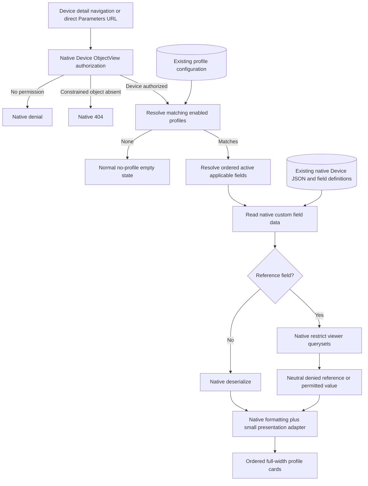

# Phase 3: Parameters tab - Research

**Researched:** 2026-11-07
**Domain:** Native NetBox Device model views, custom-field presentation and constrained access
**Confidence:** MEDIUM — official documentation cross-checked against the running pinned runtime; see Metadata for the confidence seam limitation.

<user_constraints>
## User Constraints (from CONTEXT.md)

The following locked decisions, discretion and deferred scope are copied verbatim from the phase context. [VERIFIED: .planning/phases/03-parameters-tab/03-CONTEXT.md:19-85,149-151]

<!-- DATA_6da83c10_START -->
### Tab visibility and empty states
- **D-01:** Show the Parameters tab when at least one enabled profile matches the
  Device, subject to native Device viewing access. Hide it when none match, keeping
  unrelated Devices uncluttered.
- **D-02:** An authorized direct visit with no matching profiles displays a normal
  empty state: “No parameter profiles apply to this device.” Apply authorization
  before evaluating or disclosing the empty state; do not redirect or grant access.
- **D-03:** A matching profile with no currently available fields remains a section
  with “No fields are available in this profile.” Matching controls tab visibility;
  populated values and field count do not. This avoids silently losing a section
  when an All-mode profile temporarily has no active fields.
- **D-04:** No profile-management permission is required just to view a Device's
  Parameters tab. Do not expose profile administration actions or links without
  their own native permissions. Matching is presentation, never authorization.

### Relevant empty values
- **D-05:** Show every resolved relevant field, including unset values. Use a muted
  “Not set” placeholder so missing data is distinct from an excluded field.
- **D-06:** Do not use truthiness to detect missing values: false and numeric zero
  are real values. Use native field-type semantics for null, empty text and empty
  multi-value collections; preserve meaningful JSON values, including empty JSON
  structures, rather than treating all false-like objects as unset.
- **D-07:** Profile selection determines presentation in Parameters, independently
  of native main-detail `ui_visible` presentation settings. Hidden and If Set fields
  may therefore appear here, including unset fields, as explicitly required by
  docs/REQUIREMENTS.md. Do not change those native settings. This is not permission
  to bypass actual native object/field authorization or related-object restrictions.

### Section and field presentation
- **D-08:** Render one full-width section per matching profile in a vertical stack,
  expanded by default. Reuse NetBox's native card and label/value table styling,
  with responsive wrapping. Do not add nested groups, collapse controls or saved
  per-user layout state in this phase.
- **D-09:** Use the profile title as its heading, preserving duplicate titles and
  the established display_order/title/created/pk order. Within each section use
  Selected membership order or All native active-field order from Phase 2.
- **D-10:** Display the native field label, falling back to its internal name.
  Reuse native field-description/help presentation where available, keeping help
  secondary to values. Do not add filter summaries, mode labels or administrative
  metadata to Device sections.
- **D-11:** Repeat a shared field in each applicable section with identical native
  value and formatting. Read directly from Device native custom-field data; do not
  introduce copied values, plugin value storage or import/synchronization steps.

### Native and complex values
- **D-12:** Prefer the supported NetBox runtime's native custom-field rendering
  utilities for all applicable field types. Preserve native choice labels,
  booleans, dates, numeric formatting, URLs, object references and multi-values.
  Research the exact 4.7.4 integration rather than inventing a parallel formatter.
- **D-13:** Preserve full long text and line breaks, with safe wrapping. Render
  JSON readably through native formatting and contain horizontal overflow locally
  when necessary. Do not silently truncate values or require a new modal to read
  them. Preserve native sanitization, safe link handling and permission behavior.
- **D-14:** Enforce native constrained Device access on navigation and direct URLs;
  handle inaccessible related objects according to native rendering behavior.
  Profile matching and profile administration access confer no additional rights.
- **D-15:** Keep this phase read-only, without an inactive Edit Parameters button.
  Phase 4 supplies the authorized edit action and deduplicated native form.

### Agent's Discretion
The user explicitly delegated all four proposed discussion areas: “You can make
the decisions based on best practices and your own recommendations.” The defaults
above are agent recommendations adopted under that delegation, not individually
selected user answers. Exact markup, native integration points, spacing and help
presentation remain implementation discretion within these behaviors. Native
permission semantics must be investigated against the pinned runtime; escalate a
real conflict with product requirements rather than silently weakening access.

### Deferred Ideas (OUT OF SCOPE)
No new scope was proposed. Native value editing and a deduplicated Edit Parameters
page remain Phase 4; full workflow/release verification remains Phase 5.
<!-- DATA_6da83c10_END -->
</user_constraints>

## Project Constraints (from AGENTS.md)

- Read the agreed product requirements before planning or implementing; they supersede the older panel design. [VERIFIED: AGENTS.md:3-5]
- Follow current workflow state, roadmap and traceable requirements; read README and CLAUDE background. [VERIFIED: AGENTS.md:7-12]
- Requirements alone do not authorize later implementation; this deliverable is research only. [VERIFIED: AGENTS.md:14-16]
- Use the canonical root checkout; the exact branch instruction is “milestone/custom-field-profiles.” Do not create worktrees or per-phase branches, and never edit or prune the preserved recovery source. [VERIFIED: AGENTS.md:18-20]
- Additional operational background requires native PostgreSQL/container testing, never printing generated credentials, and restarting services before—not during—a test run. [VERIFIED: CLAUDE.md, Development and verification]

<phase_requirements>
## Phase Requirements

Descriptions below are copied from the traceability authority. [VERIFIED: .planning/REQUIREMENTS.md, Parameters tab]

| ID | Description | Research Support |
|----|-------------|------------------|
| TAB-01 | Provide a dedicated Parameters tab on Device detail pages. | Native model-view decorator, early registration and ViewTab. |
| TAB-02 | Render matching enabled profiles as ordered sections with ordered fields. | Existing resolvers, ordered list context, per-profile card. |
| TAB-03 | Display native values consistently, including duplicates across sections, with field-type-appropriate formatting and relevant empty fields handled clearly. | Native deserialization/rendering plus small empty/URL/line-break adapter. |
| AUTH-01 | Tab and direct view URLs enforce native object/field viewing rules; matching filters do not confer access. | Device ObjectView restriction before resolution; native restrictions for related references; non-admin viewer tests. |
</phase_requirements>

## Summary

Use a native Device `ObjectView` registered through `register_model_view`, with a `ViewTab` whose visibility depends only on matching enabled profiles. Build read-only section context through the existing matching and field resolvers after native Device authorization. Keep the old template extension inert. The official plugin API and running source agree on this integration. [CITED: https://netbox.readthedocs.io/en/stable/plugins/development/views/#additional-tabs] [VERIFIED: runtime utilities/views.py:246-291,356-393; netbox/views/generic/object_views.py:40-88; netbox_custom_field_profiles/matching.py:9-26,40-56]

Reuse native `customfield_value` for normal values, but add a deliberately small adapter. Read-only probes confirmed native preservation of false, zero and empty JSON; they also exposed native URL text truncation and object deserialization without user restrictions. Apply native constrained related-object querysets before formatting, use the required unset placeholder, and retain full URL text and long-text line breaks. This respects D-07/AUTH-01 rather than reproducing the native formatter's missing reference guard. The orchestrator confirmed this interpretation under the user's delegated implementation discretion. [VERIFIED: runtime utilities/templatetags/builtins/tags.py:49-83; utilities/templates/builtins/customfield_value.html:3-56; extras/models/customfields.py:843-865; utilities/querysets.py:116-146; read-only format/reference probes in this research session]

**Primary recommendation:** Plan a native registration tracer first, then the section/value adapter with permission tests, then integrated presentation/preservation/browser verification. No dependency installation or schema migration is needed for the recommended design. [CITED: https://netbox.readthedocs.io/en/stable/plugins/development/views/] [VERIFIED: netbox_custom_field_profiles/models.py:9-56; matching.py:9-56]

## Architectural Responsibility Map

This is the recommended responsibility assignment, grounded in native ObjectView and the existing resolver boundary. [CITED: https://netbox.readthedocs.io/en/stable/plugins/development/views/#object-views] [VERIFIED: netbox_custom_field_profiles/matching.py:9-56]

| Capability | Primary Tier | Secondary Tier | Rationale |
|------------|-------------|----------------|-----------|
| Device authority/direct URL | Frontend Server (Django) | Database | Native generic view constrains the queryset before lookup. |
| Profile relevance and field ordering | Frontend Server (Django) | Database | Reuse matching and field resolution; relevance grants no authority. |
| Native values and reference access | Frontend Server (Django) | Database | Read native JSON; restrict referenced models for the viewer. |
| Field formatting, sanitization and escaping | Frontend Server (Django) | Browser | Native tags generate safe HTML; the adapter supplies only required differences. |
| Wrapping, full-width cards, local JSON overflow | Browser | Frontend Server | Scoped markup/styles; no new application state or value cache. |
| Persistent values | Database / Storage | — | Existing native Device data remains the only persistent value source. |

## Standard Stack

### Core

| Component | Version | Purpose | Provenance |
|-----------|---------|---------|------------|
| Existing NetBox Docker runtime | 4.7.4-Docker-5.1.1 | Native Device model, generic views, tabs and renderer | Running settings probe; pin is `IMAGE = 'netboxcommunity/netbox:v4.7.4-5.1.1'`. [VERIFIED: scripts/sandbox.py:18-20,150-154; runtime settings.VERSION probe] |
| Existing Django | 6.1.2 observed in container | Templates, native test client/TestCase | `django.get_version()` probe; inherit runtime, do not install/upgrade host Django. [VERIFIED: runtime version probe; CLAUDE.md, Development and verification] |
| Existing plugin models and resolver | Repository source | Matching/ordered native fields | Modes are exactly `FIELD_MODE_SELECTED = 'selected'`, `FIELD_MODE_ALL = 'all'`; profile ordering is `['display_order', 'title', 'created', 'pk']`, membership ordering `['position', 'pk']`. [VERIFIED: netbox_custom_field_profiles/models.py:12-14,26-27,54-56] |

### Supporting

Use existing native Django/PostgreSQL testing, native card/table styles, native `url_scheme_is_allowed`, and native custom-field/Markdown/JSON rendering. No external packages are recommended. These APIs were read in the running runtime, rather than inferred from the old plugin. [VERIFIED: runtime utilities/templatetags/builtins/tags.py:49-83; utilities/templatetags/builtins/filters.py:171-208; netbox_custom_field_profiles/tests/runner.py:13-25]

### Alternatives Considered

| Instead of | Alternative | Decision |
|------------|-------------|----------|
| Native model-view registration | Injected panel/template extension | Reject: dedicated tab is locked and old extension is explicitly inert (`template_extensions = []`). [VERIFIED: netbox_custom_field_profiles/template_content.py:1-4; phase context D-08] |
| Native generic view | Manual Django view with hand-written permission checks | Reject: duplicates native permission/404 behavior. [VERIFIED: runtime utilities/views.py:125-153; netbox/views/generic/base.py:24-49] |
| Native formatter plus small adapter | Complete parallel custom formatter | Reject: would duplicate native choice labels/colors, dates, sanitization and safe URL handling. [VERIFIED: runtime utilities/templatetags/builtins/tags.py:49-83; utilities/templates/builtins/customfield_value.html:3-56] |

**Installation/version policy:** No install command. Keep the tested runtime pin; do not chase latest registry releases for this bounded phase. Registry version/publish-date checks and Package Legitimacy Audit are inapplicable because the plan installs no packages. [VERIFIED: scripts/sandbox.py:20; pyproject.toml, project dependencies]

## Architecture Patterns

### System Architecture Diagram

Recommended data flow, following the native view's actual authorization order. [VERIFIED: runtime netbox/views/generic/base.py:24-49; utilities/views.py:125-153; netbox/views/generic/object_views.py:72-88]



### Component Responsibilities and Proposed Files

The following are **proposed edit/create targets**, not claims that new files already exist. Existing integration points were opened this session. [VERIFIED: netbox_custom_field_profiles/__init__.py:13-16; views.py:1-28; matching.py:9-56; urls.py:1-10]

| Target | Responsibility |
|--------|----------------|
| `netbox_custom_field_profiles/__init__.py` | Import the decorated view module in `ready()` after `super().ready()` and signal setup, before URL assembly. |
| `netbox_custom_field_profiles/views.py` | Add Device Parameters ObjectView and ViewTab; use a collision-resistant plugin-specific registration name. |
| New `netbox_custom_field_profiles/presentation.py` | Read-only section/row construction, type-aware unset detection, restricted reference resolution and per-request duplicate-value reuse. |
| New `templates/netbox_custom_field_profiles/device_parameters.html` | Extend native Device base; stack profile cards and the two required empty states. |
| New `templatetags/parameter_tags.py` plus small value partial | Delegate normal values to native tag; adapt unset, full URL text and any long-text presentation need. |
| Existing `matching.py`, models, signals | Reuse current semantics; avoid replacing or extending lifecycle/filter rules. |
| Existing `urls.py` | Keep profile CRUD routes; core Device URLs are supplied by native model registration. |
| New native `test_parameters.py`, `test_parameter_rendering.py`, `test_parameter_permissions.py` | Integration tracer, rendering matrix, access/preservation regressions. |

**Registration timing:** Import decorated views from plugin `ready()`, not only from plugin `urls.py`. Native core URLs materialize registered views into a list; a late registration is skipped by native tab rendering if its URL cannot reverse. Verify in a fresh process after restart with `reverse()`/`resolve()` and a real Device GET. [VERIFIED: runtime utilities/urls.py:12-50; dcim/urls.py:95-96; utilities/templatetags/tabs.py:33-46; netbox/plugins/__init__.py:132-167]

**Tab visibility:** Set `ViewTab.visible` to a boolean match check, with native Device view permission; do not use field count or populated-value count. Its callback receives the object, not the request, so Device authority must already be established by the native parent view. Recheck authority at the destination through ObjectView. [VERIFIED: runtime utilities/views.py:246-291; utilities/templatetags/tabs.py:19-40; phase context D-01–D-04]

**Independent visibility:** Do not call native grouped-field presentation for row selection: it filters hidden/If Set fields. Resolve fields through the existing profile helper and read `.custom_field_data.get(field.name)`. Native `get_for_model()` selects applicable active definitions without requiring a separate permission to administer CustomField definitions. Do not add a blanket requirement for profile or CustomField administration access to read Device values. [VERIFIED: runtime netbox/models/features.py:265-292; extras/models/customfields.py:71-106; netbox_custom_field_profiles/matching.py:40-56; phase context D-04,D-07]

**Reference authority:** The native deserializer and native `linkify` have no user argument and do not restrict related objects. Resolve object/multiobject references with the native model queryset's `restrict(user, 'view')` before passing values to native formatting. For a denied reference display a neutral unavailable placeholder without label, ID, URL, or count of hidden references; do not label stored-but-denied values as unset. Mixed multiobject collections may show permitted objects, without disclosing denied members. Keep empty matching sections and do not let related access determine tab visibility. This is the adopted interpretation of D-07/AUTH-01 under delegated discretion, with the native formatter limitation made explicit. [VERIFIED: runtime extras/models/customfields.py:859-864; utilities/templatetags/builtins/filters.py:46-63; utilities/querysets.py:116-146; session constrained-reference probe; phase context D-03,D-07,D-14]

**Field label difference:** Native CustomField `__str__` prettifies an unlabeled internal name (`self.label or self.name.replace('_', ' ').capitalize()`). D-10 explicitly asks for the internal-name fallback, so render `field.label|default:field.name` rather than blindly using `{{ field }}`. Reuse the native escaped description tooltip pattern. [VERIFIED: runtime extras/models/customfields.py:342-343; templates/extras/panels/custom_fields.html:14-21; phase context D-10]

### Type and Empty-Value Contract

Runtime type definitions were opened: `TYPE_TEXT = 'text'`, `TYPE_LONGTEXT = 'longtext'`, `TYPE_INTEGER = 'integer'`, `TYPE_DECIMAL = 'decimal'`, `TYPE_BOOLEAN = 'boolean'`, `TYPE_DATE = 'date'`, `TYPE_DATETIME = 'datetime'`, `TYPE_URL = 'url'`, `TYPE_JSON = 'json'`, `TYPE_SELECT = 'select'`, `TYPE_MULTISELECT = 'multiselect'`, `TYPE_OBJECT = 'object'`, `TYPE_MULTIOBJECT = 'multiobject'`. Native general empty values are exactly `CUSTOMFIELD_EMPTY_VALUES = (None, '', [])`; JSON rendering deliberately uses `value is not None`. [VERIFIED: runtime extras/choices.py:13-27; extras/constants.py:6-7; utilities/templates/builtins/customfield_value.html:23-24]

Use the following presentation policy, derived from D-05/D-06 and the native type branches. This table is implementation guidance; it does not change native data or validation. [VERIFIED: phase context D-05,D-06; runtime utilities/templates/builtins/customfield_value.html:3-56]

| Value/type | Required display |
|------------|------------------|
| Missing key or explicit null, any type | Muted “Not set”. |
| Empty text, longtext, URL, single choice | Muted “Not set”. |
| Empty multiselect/multiobject collection | Muted “Not set”; distinguish stored references denied by access checks. |
| Boolean false; integer/decimal zero | Native meaningful value, never placeholder. |
| JSON empty object, array, string, boolean false or zero | Native formatted JSON, all meaningful; only null/missing is unset. |
| Date/date-time | Native deserialize then native date formatting; include date-time in coverage even though the older product examples omit it. |
| Select/multiselect | Native label/color resolution, including a stored value different from its label. |
| Longtext | Native sanitized Markdown; scoped presentation must keep line breaks and full content readable. |
| URL | Use native scheme decision and autoescape, but full visible text. Native tag truncates at 70 characters. |

**No cross-request value cache:** Build rows from the authorized Device instance on each request. Within a request, reuse a value/render context per field so duplicates remain identical and object references are not queried repeatedly. A script-written native value then appears on the next normal request. [VERIFIED: phase context D-11; runtime netbox/models/features.py:206-220; netbox_custom_field_profiles/matching.py:40-56]

### Anti-Patterns to Avoid

- Applying native `ui_visible` to Parameters selection contradicts the locked independent presentation behavior. [VERIFIED: phase context D-07]
- Sorting by a dictionary keyed by profile title loses duplicate-title sections; use ordered sequences. [VERIFIED: netbox_custom_field_profiles/models.py:16,26-27; phase context D-09]
- Passing raw reference IDs directly to the template, or assuming `linkify` authorizes access, bypasses native constrained querysets. [VERIFIED: runtime extras/models/customfields.py:859-864; utilities/templatetags/builtins/filters.py:46-63]
- Calling a value false-like to mean empty breaks boolean false, zero and JSON empty structures. [VERIFIED: session read-only format probes; phase context D-06]
- Adding a global template override for native custom-field rendering would change existing screens. Keep adapters in the plugin template namespace. [VERIFIED: phase context D-07,D-12,D-13; docs/REQUIREMENTS.md, Native custom fields remain authoritative]

## Don't Hand-Roll

| Problem | Don't Build | Use Instead | Why |
|---------|-------------|-------------|-----|
| Device permission/constraint handling | Manual pk lookup plus boolean permission check | Native ObjectView | Restricts queryset before lookup. [VERIFIED: runtime utilities/views.py:125-153] |
| Related-object authority | Custom policy engine | Native `.restrict(user, 'view')` | Applies native superuser/exempt/action/constraint semantics. [VERIFIED: runtime utilities/querysets.py:116-146] |
| Field relevance/order | Separate filters or model-order logic | Existing matching and field helpers | Already implements the phase's inherited semantics. [VERIFIED: netbox_custom_field_profiles/matching.py:9-56] |
| Choice/date/JSON/Markdown rendering | Parallel type formatter/sanitizer | Native tag and filters | Covers labels/colors, ISO formatting, escaped JSON and sanitized Markdown. [VERIFIED: runtime utilities/templates/builtins/customfield_value.html:3-56; utilities/templatetags/builtins/filters.py:171-208,225-253] |
| URL safety | Scheme string allowlist | Native `url_scheme_is_allowed`/native tag context | Preserves runtime configured safety while showing full text. [VERIFIED: runtime utilities/templatetags/builtins/tags.py:60-82] |

**Key insight:** The adapter should change selection, access enforcement and a few presentation details; it should delegate field semantics and sanitization to NetBox. [VERIFIED: phase context D-07,D-12,D-13; runtime sources above]

## Common Pitfalls

### 1. Decorator registers too late
**Failure:** Tab is absent or URL does not reverse after a fresh restart. **Cause:** core URL list was built before plugin URL import registered the view. **Prevention:** early ready import and fresh-process reverse/resolve integration check. [VERIFIED: runtime utilities/urls.py:24-50; utilities/templatetags/tabs.py:42-46]

### 2. Native helper silently reintroduces detail-page visibility
**Failure:** Hidden fields or unset If Set fields disappear. **Cause:** using grouped native field presentation. **Prevention:** retain profile field resolution, use native formatting only after selection. Test all native visibility settings without mutating them. [VERIFIED: runtime netbox/models/features.py:280-290; phase context D-07]

### 3. Native renderer mistaken for authorization
**Failure:** A restricted reference's label/link appears. **Cause:** deserializer/linkify use ordinary model lookup. **Prevention:** native reference queryset restriction before formatting; test both entirely denied and mixed collections with an authenticated constrained user. [VERIFIED: runtime extras/models/customfields.py:859-864; utilities/templatetags/builtins/filters.py:46-63; session reference probe]

### 4. Correct HTML still loses information visually
**Failure:** URL text truncates; single newlines collapse; JSON expands the entire viewport. **Cause:** native URL truncation, normal HTML whitespace and preformatted content. **Prevention:** small full-URL adapter, scoped line-break treatment preserving native Markdown sanitation, and local pre overflow. Require browser checks at narrow width and with long content. [VERIFIED: runtime utilities/templates/builtins/customfield_value.html:7-8,17-24; session format probes; phase context D-13]

### 5. Empty profile confused with no match
**Failure:** Matching All-mode profile with zero active fields hides tab or vanishes. **Prevention:** compute match before resolving fields; render the matching section's dedicated empty message. [VERIFIED: phase context D-01,D-03; netbox_custom_field_profiles/matching.py:9-26,40-56]

### 6. New static extension omitted from distribution
**Failure:** CSS works in a source mount but is missing after packaging. **Cause:** current package-data pattern includes JS and templates only. **Prevention:** prefer existing utilities/scoped template styling; if adding CSS, explicitly include it in package data and verify the wheel content. Existing pattern is `['templates/**/*.html', 'static/**/*.js']`. [VERIFIED: pyproject.toml, tool.setuptools.package-data]

## Code Examples

The following are proposed integration skeletons, not existing implementation. New registration/template names are design choices, not inferred existing paths. Native API usage is supported by official docs and opened runtime source. [CITED: https://netbox.readthedocs.io/en/stable/plugins/development/views/#additional-tabs] [VERIFIED: runtime netbox/views/generic/object_views.py:55-88; utilities/views.py:263-291,356-393]

```python
from dcim.models import Device
from netbox.views.generic import ObjectView
from utilities.views import ViewTab, register_model_view
from .matching import get_matching_profiles

@register_model_view(Device, name='custom_field_profiles', path='parameters')
class DeviceParametersView(ObjectView):
    queryset = Device.objects.all()
    template_name = 'netbox_custom_field_profiles/device_parameters.html'
    actions = ()  # Read-only phase: no plugin edit action.
    tab = ViewTab(
        label='Parameters',
        permission='dcim.view_device',
        visible=lambda device: bool(get_matching_profiles(device)),
    )

    def get_extra_context(self, request, instance):
        # Native ObjectView already authorized and retrieved this Device.
        return {'sections': build_sections(instance, request.user)}
```

The permission action in this skeleton is native: ObjectView derives `get_permission_for_model(self.queryset.model, 'view')`; the official permission docs name `dcim.view_device`. No profile-management permission belongs here. [VERIFIED: runtime netbox/views/generic/object_views.py:55-56; phase context D-04] [CITED: https://netbox.readthedocs.io/en/stable/administration/permissions/#viewing-objects]

```django
{# Proposed plugin row partial; row is a prepared presentation record. #}
<th scope="row">{{ row.field.label|default:row.field.name }}</th>
<td>
  
    <span class="text-muted">Unavailable</span>
  
    <span class="text-muted">Not set</span>
  
    
  
</td>
```

Add the full-URL branch separately using native safety context; do not replace native URL safety with the skeleton's generic delegation. For longtext retain native Markdown sanitation and add scoped line-break styling or a narrowly reviewed equivalent. These are required adapter details, not a request to write another formatter. [VERIFIED: runtime utilities/templatetags/builtins/tags.py:60-82; utilities/templatetags/builtins/filters.py:171-198; phase context D-13]

### Read-Only Probe Evidence

Executed through the existing sandbox Django shell, with unsaved CustomField objects and read-only database queries. Output excerpts below are session-generated evidence. [VERIFIED: session runtime format/reference probes]

<!-- DATA_2fb47509_START -->
```text
RUNTIME 4.7.4-Docker-5.1.1 Django 6.1.2
boolean False '<i class="mdi mdi-close-thick text-danger" title="False"></i>'
integer 0 '0'
decimal 0 '0'
json {} '<pre>{}</pre>'
json [] '<pre>[]</pre>'
json False '<pre>false</pre>'
json 0 '<pre>0</pre>'
json '' '<pre>&quot;&quot;</pre>'
longtext 'line one\nline two' '<div class="rendered-markdown"><p>line one\nline two</p></div>'
url 'javascript:alert(1)' 'javascript:alert(1)'
NATIVE_REFERENCE_GUARD_ABSENT: deserialize returns an object denied by restrict(None,view); linkify still emits its link. No data mutated.
CONSTRAINED_REFERENCE_PROBE: native deserializer still resolves the Site; native restrict(view) correctly excludes it for an authenticated constrained subject. No data mutated.
```
<!-- DATA_2fb47509_END -->

The constrained probe used a nonpersistent authenticated subject with a Site view permission constrained to a nonexistent primary key; it confirms queryset enforcement without creating users or changing live permission data. The native long-URL probe emitted a complete href with visibly truncated anchor text; retain complete text in Parameters. [VERIFIED: session runtime reference/URL probes]

## State of the Art

| Earlier/local approach | Required current approach | Impact |
|------------------------|---------------------------|--------|
| Retired injected main-page panel | Native registered Device tab | Keep old template extension inert. [VERIFIED: netbox_custom_field_profiles/template_content.py:1-4; phase context D-01] |
| Assume every native JSON field key exists | `.get(field.name)` | Current official docs describe absent keys as unset and identify the change in 4.6.8. [CITED: https://netbox.readthedocs.io/en/stable/customization/custom-fields/#creating-custom-fields] |
| Treat every assigned definition as immediately live | Reuse active-field resolver | Native provisioning/deleting statuses exist and current resolver excludes them. [VERIFIED: runtime extras/models/customfields.py:71-106; netbox_custom_field_profiles/matching.py:44-52] |

## Assumptions Log

No product or compatibility decisions in this document rely on training-only assumptions. Proposed filenames, neutral unavailable text, registration name and implementation task grouping are recommendations under delegated discretion. Runtime mechanics were read/probed, and remaining UI checks are explicit validation work rather than assumed success. [VERIFIED: phase context, Agent's Discretion; session runtime probes]

| # | Claim | Section | Risk if Wrong |
|---|-------|---------|---------------|
| — | No `[ASSUMED]` factual claims | — | — |

## Open Questions

1. **[RESOLVED] Browser proof of full-value presentation:** the planning disposition is to require actual desktop/narrow browser acceptance in **03-04-T2**, recorded in 03-UAT.md; source inspection and server HTML cannot establish wrapping/overflow. That task covers full URLs, long text/line breaks, escaped Markdown, nested JSON and 20–30-field cards. Browser unavailability leaves UAT pending and acceptance incomplete. This resolves ownership and the required evidence, not the execution result: no browser pass is claimed. [VERIFIED: phase context D-08,D-13; session rendering probes]
2. **[RESOLVED] Cold-start registration:** adopt the early ready import, with fresh-process reverse/resolve and real native Device navigation owned by **03-01-T1**, before expansion. **03-04-T2** owns the real web startup/restart and browser-path confirmation outside active tests. Those are pending execution checks; no successful Parameters registration or restart is claimed by research. [VERIFIED: netbox_custom_field_profiles/views.py:1-28; __init__.py:13-16; runtime utilities/urls.py:24-50]
3. **[RESOLVED] Inherited documentation lag:** current STATE/PROJECT govern Phase 2 completion; stale README/CLAUDE/profile-guide pending wording is not a blocker or a changed product requirement. **03-04-T2** owns scoped capability/status corrections and records only actual new tab evidence, retaining pending browser results when applicable. This settles the documentation authority/disposition without asserting those edits or checks have executed. [VERIFIED: README.md, Agreed milestone direction; CLAUDE.md, Implemented through Phase 2; .planning/STATE.md, Current Position; .planning/PROJECT.md:18-25]

## Environment Availability

Observed read-only on the research date; no services restarted and no dependencies installed. [VERIFIED: session compose ps/version probes]

| Dependency | Required By | Available | Version | Fallback |
|------------|-------------|-----------|---------|----------|
| Host Python | Existing sandbox runner | Yes | 3.12.2 | — |
| Docker Engine CLI / Compose | Pinned native environment | Yes | 29.9.2 / v5.6.1 | — |
| NetBox web/worker | Native integration | Healthy | 4.7.4-Docker-5.1.1 | Existing `make up` if stopped |
| PostgreSQL | Native isolated tests | Healthy | Container image postgres:18-alpine | — |
| Valkey services | Runtime/cache | Healthy | Container image valkey/valkey:9.1-alpine | — |
| Context7 MCP / ctx7 CLI | Documentation lookup | Not available in this agent | — | Official docs + opened runtime source used |

**Missing dependencies with no fallback:** None identified for this design. **Missing dependencies with fallback:** Context7 documentation lookup used official documentation and runtime source. Browser availability was not probed during research; browser acceptance must be recorded honestly during execution. [VERIFIED: tool inventory, command lookup, runtime inventory]

## Validation Architecture

Validation is enabled by default because project config does not explicitly disable it. Security is similarly enabled by default. The observed config contains only the workflow entries `_auto_chain_active` and `use_worktrees`; no test/security disable is inferred. [VERIFIED: .planning/config.json:1-6]

### Test Framework

| Property | Value |
|----------|-------|
| Framework | Native Django 6.1.2 TestCase/Client with isolated PostgreSQL runner. [VERIFIED: runtime django.get_version(); netbox_custom_field_profiles/tests/test_permissions.py:5-11,17; tests/runner.py:13-25] |
| Config/runner | Existing native runner; proposed new modules below need no new framework. Runner's exact class is `ProfileTestRunner`. [VERIFIED: netbox_custom_field_profiles/tests/runner.py:6-25] |
| Quick command | `python3 scripts/test_profiles.py --label netbox_custom_field_profiles.tests.test_parameters` — proposed new module; command form is already supported. [VERIFIED: scripts/test_profiles.py:34-42,61-66] |
| Full suite | `make test-profiles`; required baseline `make test`. [VERIFIED: Makefile:35-42] |

### Phase Requirements → Test Map

Files below are proposed Wave 0 additions; commands are planned, not claimed executed. Keep focused cases below 30 seconds where practical; the full suite may take longer. Existing runner preserves live snapshots and rejects zero-test success. [VERIFIED: scripts/test_profiles.py:34-57; tests/runner.py:6-25]

| Req ID | Behavior | Test Type | Automated Command | File Exists? |
|--------|----------|-----------|-------------------|--------------|
| TAB-01 | Native registered URL, real Device navigation, active tab, no main-page panel, matching/no-match/zero-fields states | Native integration | `python3 scripts/test_profiles.py --label netbox_custom_field_profiles.tests.test_parameters` | No — Wave 0 |
| TAB-02 | CMTS/CPE/shared matches, disabled exclusion, duplicate titles, stable profile/Selected/All ordering, dynamic fields | Native integration | Same `test_parameters` label | No — Wave 0 |
| TAB-03 | All 13 native types, false/zero, absent/null, empty JSON/text/collections, labels/colors, duplicates and next-request native writes | Native render/integration | `python3 scripts/test_profiles.py --label netbox_custom_field_profiles.tests.test_parameter_rendering` | No — Wave 0 |
| TAB-03 | XSS/Markdown/unsafe URL, long URL complete text, JSON escaping, required unset placeholder, raw-name fallback | Native render/security | Same `test_parameter_rendering` label | No — Wave 0 |
| AUTH-01 | Viewer without profile/field-definition administration access; denied action; allowed/denied constrained Device direct URL; no-match authority first | Native permission integration | `python3 scripts/test_profiles.py --label netbox_custom_field_profiles.tests.test_parameter_permissions` | No — Wave 0 |
| AUTH-01 | Authenticated reference constraints: object denied, multiobject mixed/all denied, labels/IDs/links absent; profile administration does not grant Device access | Native permission integration | Same `test_parameter_permissions` label | No — Wave 0 |
| TAB-03/AUTH-01 | GET and forged POST leave all Device/native-field/profile data unchanged; POST unsupported rather than edit behavior | Native integration/preservation | Same `test_parameter_permissions` label | No — Wave 0 |
| TAB-01/TAB-03 | Full-width layout, desktop/narrow wrapping, preserved line breaks, JSON local overflow, native help tooltip and no inactive edit control | Browser/manual | Document actual browser evidence; server HTML tests cannot prove visual layout | Manual during execution |

### Sampling Rate

- Per task: focused new module plus affected existing permission/preservation tests. Existing command grammar is confirmed in runner source. [VERIFIED: scripts/test_profiles.py:34-42,61-66]
- Per integrated wave: `make test-profiles`; run baseline `make test` at the final gate. [VERIFIED: Makefile:35-42]
- Phase gate: full native suite, required baseline and actual browser evidence before verification. Do not reset the live sandbox for feature tests or restart while tests run. [VERIFIED: CLAUDE.md, Development and verification; tests/runner.py:13-25]

### Wave 0 Gaps

- Create the three focused native test modules listed above, sharing/reusing existing Device fixture patterns and native ObjectPermission grants. Existing permission tests expose reusable `grant`/user patterns. [VERIFIED: netbox_custom_field_profiles/tests/test_permissions.py:17-41]
- Add a fresh-process reverse/resolve/navigation tracer before broad formatting work; import/registry correctness cannot be proven by a unit helper test. [VERIFIED: runtime utilities/urls.py:24-50; utilities/templatetags/tabs.py:42-46]
- No framework installation. Keep native test database isolation/live-preservation assertions. [VERIFIED: scripts/test_profiles.py:34-57; tests/runner.py:13-25]

## Security Domain

Security enforcement is enabled by default under the workflow contract; the project configuration does not disable it. Use ASVS **5.0.0** naming rather than copying obsolete category numbers from older templates. Official release information identifies 30 May 2025 as its publication date. [VERIFIED: .planning/config.json:1-6] [CITED: https://asvs.owasp.org/]

### Applicable ASVS Categories

The applicability column is the phase-specific responsibility map; category names and relevant controls come from the official standard. [CITED: https://raw.githubusercontent.com/OWASP/ASVS/v5.0.0/5.0/en/0x10-V1-Encoding-and-Sanitization.md] [CITED: https://raw.githubusercontent.com/OWASP/ASVS/v5.0.0/5.0/en/0x17-V8-Authorization.md]

| ASVS Category | Applies | Standard Control |
|---------------|---------|------------------|
| V1 Encoding and Sanitization | Yes | Django autoescape; native sanitized Markdown and permitted URL schemes; safe text for headings/help/JSON. |
| V8 Authorization | Yes | Native Device ObjectView constraint enforcement and native restricted reference querysets; no relevance-based authority. |
| Authentication/session controls | Inherited | Use existing NetBox login/session machinery; phase adds no authentication/session mechanism. |
| Cryptographic controls | No new implementation | No crypto or new secrets in read-only tab. |
| Input validation/business logic | Bounded | Native pk lookup and configured profile resolution; reject mutations; do not treat content as executable templates. |

### Known Threat Patterns for This Stack

The mitigations map native implementation evidence to ASVS authorization/encoding controls. [VERIFIED: runtime utilities/views.py:125-153; utilities/querysets.py:116-146; utilities/templatetags/builtins/tags.py:60-82; utilities/templatetags/builtins/filters.py:171-208] [CITED: https://raw.githubusercontent.com/OWASP/ASVS/v5.0.0/5.0/en/0x17-V8-Authorization.md]

| Pattern | STRIDE | Standard Mitigation |
|---------|--------|---------------------|
| Direct URL reads another Device | Information disclosure | Constrained native Device queryset before matching and empty state. |
| Inaccessible custom-field reference reveals a name/link | Information disclosure | Native related model restriction before formatter; neutral placeholder. |
| Headings/help/text/JSON contains HTML | Tampering / information disclosure | Autoescape; native JSON filter; no plugin mark_safe of stored content. |
| Stored Markdown/unsafe URL executes script | Tampering | Native Markdown sanitization and URL scheme policy, retained in full-text adapter. |
| GET or forged POST changes native/profile data | Tampering | Read-only ObjectView, no mutation handler; snapshots around requests. |
| Profile administration permission reused as Device authority | Elevation of privilege | Device permission derived from Device queryset; no profile permission substitutes. |

## Sources

### Direct authoritative runtime/source evidence

- Running pinned NetBox: `utilities/views.py` (ObjectPermissionRequiredMixin, ViewTab, decorator), `utilities/urls.py` (URL materialization), `utilities/templatetags/tabs.py` (tab permission/URL handling), `netbox/views/generic/base.py` and `object_views.py` (authorization and rendering order). Opened through sandbox Django inspection with line numbers. [VERIFIED: session source inspection]
- Running pinned NetBox: `extras/models/customfields.py`, `extras/choices.py`, `extras/constants.py`, `netbox/models/features.py`, `extras/ui/panels.py`, native builtins tags/filters/value template, Device base and generic object template. Opened through sandbox source inspection; formatter/reference probes were read-only. [VERIFIED: session source inspection/probes]
- Repository: phase context, product/workflow requirements, AGENTS/README/CLAUDE, models/matching/views/plugin init/inert extension, runner/permission tests/Makefile/package metadata. Source-of-truth files opened this session. [VERIFIED: session repository reads]

### Official documentation (MEDIUM confidence per seam)

- [NetBox plugin views](https://netbox.readthedocs.io/en/stable/plugins/development/views/) — supported generic views, native model URL registration and additional tabs. [CITED: https://netbox.readthedocs.io/en/stable/plugins/development/views/]
- [NetBox custom fields](https://netbox.readthedocs.io/en/stable/customization/custom-fields/) — field kinds, absent-key behavior, status, UI visibility/API distinction and choice/object semantics. [CITED: https://netbox.readthedocs.io/en/stable/customization/custom-fields/]
- [NetBox object permissions](https://netbox.readthedocs.io/en/stable/administration/permissions/) — native action/constraint/queryset semantics. [CITED: https://netbox.readthedocs.io/en/stable/administration/permissions/]
- [ASVS release overview](https://asvs.owasp.org/), [V1](https://raw.githubusercontent.com/OWASP/ASVS/v5.0.0/5.0/en/0x10-V1-Encoding-and-Sanitization.md), [V8](https://raw.githubusercontent.com/OWASP/ASVS/v5.0.0/5.0/en/0x17-V8-Authorization.md) — current standard categories and controls. [CITED: https://asvs.owasp.org/]

**Lookup limitations:** Research-plan selected Context7 for NetBox questions, but no Context7 MCP/ctx7 executable was available; fallback used official docs and stronger exact-runtime inspection. Attempts to fetch pinned GitHub raw NetBox source through web returned cache-miss errors, so no claim of GitHub-source comparison is made. Official stable documentation has no release-specific publication date; runtime evidence governs version-specific behavior. Graphify status reported disabled, so no graph-derived assumptions were used. [VERIFIED: session tool/seam results]

## Metadata

**Confidence breakdown:**
- Standard stack: MEDIUM by seam; pinned runtime/version and healthy services directly observed. [VERIFIED: session version/inventory probes]
- Architecture: MEDIUM by seam; official APIs agree with opened runtime view/tab/URL code. Cold-start registration is an explicit integration test. [CITED: https://netbox.readthedocs.io/en/stable/plugins/development/views/]
- Pitfalls: MEDIUM by seam; false/zero/JSON/URL/Markdown/reference behaviors were positively probed, with precise source cross-checks. [VERIFIED: session rendering/reference probes]

The code seam returns MEDIUM for `websearch --verified` and for Context7; its HIGH tier additionally depends on package-legitimacy ground truth. This phase installs no package, so this document does not inflate the seam's confidence tier. `[VERIFIED: runtime/repo]` denotes direct authoritative source observation, separate from this package-centric provider rating. [VERIFIED: /Users/mwallraf/.codex/gsd-core/bin/lib/research-provider.cjs:46-69; session classify-confidence output]

**Research date:** 2026-11-07. **Refresh:** Recheck before implementation if runtime/source pin changes; otherwise review in 30 days. **Execution performed:** research only, read-only runtime queries/probes and research-cache writes; no production edits, installs, service restarts, schema/config changes, branches, worktrees or commits. [VERIFIED: session actions]
