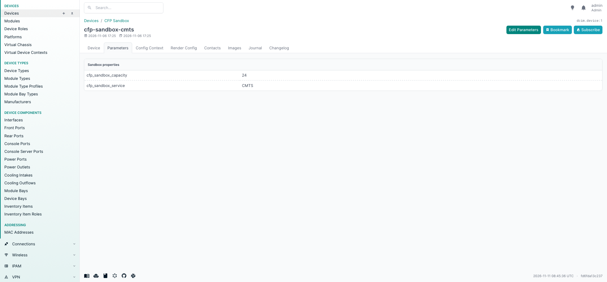
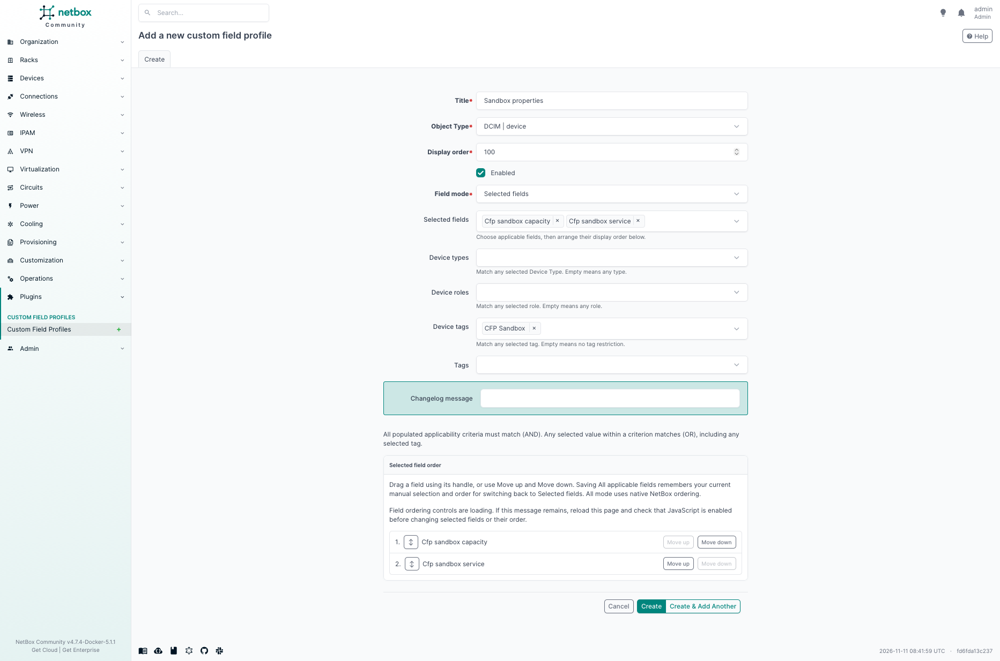

# NetBox Custom Field Profiles

Show the custom fields that matter for each Device, without cluttering its main
page. Custom Field Profiles groups existing NetBox custom fields into reusable
sections on a dedicated **Custom Fields** tab.

For example, a CMTS can show 20–30 service fields while a CPE shows only two,
with shared fields appearing on both.

**Your fields and values stay in NetBox.** The plugin creates no field definitions
and has no separate value storage. **Edit Custom Fields** updates native custom field
values using NetBox’s permissions and validation, so existing scripts and APIs
continue to work with the same data.

## Features

- Manage reusable profiles under **Plugins → Custom Field Profiles**.
- Match Devices automatically by Device Type, role and tags.
- Choose and order specific fields, or include all applicable fields dynamically.
- Display each matching profile as a section; edit repeated fields only once.
- Hide fields on the normal Device page using native **UI visibility → Hidden**,
  while keeping them available in Custom Fields. Native editability still applies.

## Screenshots

**Device Custom Fields:** a matching profile presents existing native field values,
with one action to edit the relevant custom fields.
The capture below predates the label change and shows “Parameters” / “Edit Parameters”.



<details>
<summary><strong>Profile configuration</strong> — field selection, order and matching rules</summary>

Select existing Device fields, arrange their order, and choose which Devices match.



</details>

## Compatibility

Supports **Devices**. Tested with **NetBox 4.7.4** and NetBox Docker **5.1.1**.
The declared minimum is NetBox 4.7.0; other versions have not been verified.

## Quick installation

For a standard NetBox installation under `/opt/netbox`, install directly from
GitHub using NetBox’s normal plugin installation process:

1. Add this line to `/opt/netbox/local_requirements.txt`:

   ```text
   netbox-custom-field-profiles @ git+https://github.com/mwallraf/netbox-custom-params-tab.git
   ```

2. Add the plugin to the existing `PLUGINS` list in NetBox’s `configuration.py`:

   ```python
   PLUGINS = [
       # Your other plugins...
       'netbox_custom_field_profiles',
   ]
   ```

3. Run NetBox’s upgrade script to install requirements, apply migrations and
   collect static files, then restart its services:

   ```sh
   sudo /opt/netbox/upgrade.sh
   sudo systemctl restart netbox netbox-rq
   ```

No plugin-specific settings are required. For Docker, wheel installation and
runtime details, see the [installation guide](docs/installation.md)
and the [NetBox plugin installation documentation](https://netboxlabs.com/docs/netbox/plugins/installation/).

## Get started

1. Create your fields in NetBox’s built-in **Custom Fields** administration and
   make them applicable to Devices.
2. Open **Plugins → Custom Field Profiles**, add a profile, select its fields,
   and optionally set Device Type, role or tag rules. Enable it and save.
3. Open a matching Device’s **Custom Fields** tab. Users with native Device change
   permission can choose **Edit Custom Fields** to update editable values.

Different rule types combine with **AND**; values within a rule combine with
**OR**. A tag rule matches any selected tag. Profiles without rules apply to all
Devices. Matching never grants additional permissions.

## Documentation

- [Documentation index](docs/README.md) — choose the right user or maintainer guide.
- [User guide](docs/user-guide.md) — profiles, native values and reducing clutter.
- [Installation guide](docs/installation.md) — supported runtime and deployment details.
- [Profile administration](docs/administration.md) — ordering, rules and field lifecycle behavior.
- [Troubleshooting](docs/troubleshooting.md) — common UI and deployment problems.
- [Maintainer guides](docs/development/README.md) — sandbox, architecture and testing.
- [Report an issue](https://github.com/mwallraf/netbox-custom-params-tab/issues).

## Development

With Docker Compose, Python 3 and Make installed:

```sh
git clone https://github.com/mwallraf/netbox-custom-params-tab.git
cd netbox-custom-params-tab
make setup
```

Open <http://127.0.0.1:18047>. Generated administrator credentials are in the local,
ignored `.env` file. Run `make test` for baseline checks, `make test-profiles` for
the native plugin suite, and `make release-check` for installed-wheel verification.

## License

[MIT](LICENSE) © 2026 [Maarten Wallraf](https://github.com/mwallraf).
